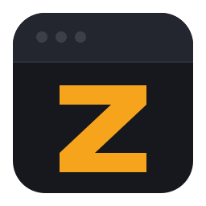
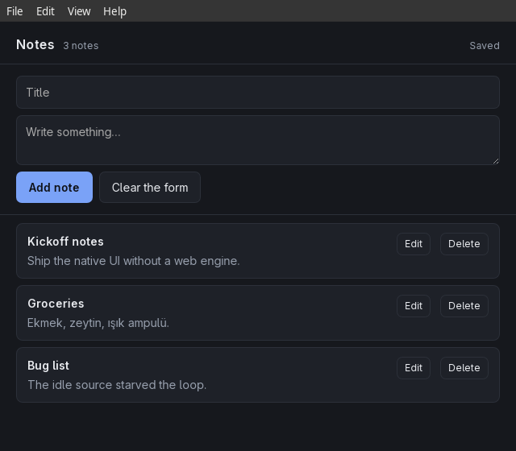

<div align="center">



# MyZig

**A desktop application framework for Zig.**

No garbage collector. No runtime to install. No JavaScript toolchain.

[](https://github.com/agnogad/myzig/actions/workflows/ci.yml)
[](https://ziglang.org)
[](LICENSE)

</div>

---

MyZig builds desktop applications where the window is one of three things:

- **A web page** in the engine the operating system already has — WebKitGTK on
  Linux, WebView2 on Windows, WKWebView on macOS. The frontend calls Zig through
  a typed IPC layer, with a TypeScript client generated from the Zig
  declarations.
- **Native UI** written in Zig and drawn by MyZig — no HTML, no JavaScript, no
  webview process.
- **Both**, in one application or in one window.

```zig
const myzig = @import("myzig");

pub fn main() !void {
    var gpa_state = std.heap.DebugAllocator(.{}){};
    defer _ = gpa_state.deinit();

    var app = try myzig.App.init(gpa_state.allocator(), .{ .name = "Hello" });
    defer app.deinit();

    _ = try app.createWindow(.{
        .title = "Hello MyZig",
        .width = 900,
        .height = 600,
        .url = "myzig://app/index.html",
    });

    try app.run();
}
```

---

## Why another framework

Most desktop frameworks answer a different question. Electron ships a browser
and a JavaScript runtime to every user. A native toolkit asks you to write your
interface three times, once per platform. MyZig takes the position that:

**The webview is already installed.** Every desktop system has one. Using it
means an application pays for a browser process only when it shows a page, and
a pure-Zig application pays for nothing at all.

**The boundary should be typed.** A page calling `Notes.add(title, body)` is a
call against a signature Zig checks at compile time, not a string sent into the
dark. `myzig generate` writes the TypeScript side from the same declarations, so
the two cannot drift apart.

**Libraries are loaded when they are used.** GTK, WebKitGTK, cairo, X11 and
libdbus are mapped with `std.DynLib` at the moment a feature needs them. An
application that draws its own interface never maps a web engine; one that only
shows a page never maps cairo. Startup stays small and fast, and a machine
missing a library fails with a clear message rather than a loader error.

**Ownership is explicit.** No collector, no hidden allocation. Every buffer has
an owner you can point at, and the framework's own test suite runs under
`DebugAllocator` with leak detection on.

---

## The Notes example

Eleven programs in [`examples/`](examples/) are built by every CI run.
[`examples/notes`](examples/notes/main.zig) is the one written to be judged:
persistent notes, a menu bar, a tray icon and typed IPC, working together.



---

## Status

**Linux is the supported platform**, and it is the only one anything has been
run on. The Windows and macOS backends are written and compile for their
targets; no one has run them. They are not claimed to work, and
[docs/platforms.md](docs/platforms.md) lists each missing feature instead of
implying otherwise.

| Area | State |
| --- | --- |
| Webview pages, `myzig://` scheme | works |
| Typed IPC, events, TypeScript client generation | works |
| Clipboard, dialogs, notifications, menus, tray, global shortcuts | works |
| Native UI: layout, software rasteriser, bitmap text, mouse input | works |
| Accessibility: AT-SPI tree, actions, values | works on Linux |
| Plugins | works |
| `myzig` command line: `new`, `generate`, `package`, `package --deb`, `doctor` | works |
| Windows backend (Win32 + WebView2) | compiles for Windows, never run |
| macOS backend (AppKit + WKWebView) | compiles for macOS, never run |
| GPU rendering, text beyond Latin-1 | not started |

Verified today: 155 unit tests, 12 examples launched under Xvfb with no console
error, and a real Wayland session with a captured window.

---

## Install

Requires **Zig 0.17.1**. On Linux, also GTK 3, WebKitGTK 4.1, cairo, and X11 or
Wayland.

```sh
git clone https://github.com/agnogad/myzig
cd myzig
zig build install
```

That puts `myzig` in `zig-out/bin`. Add it to `PATH`, or point `MYZIG_HOME` at
the checkout:

```sh
export MYZIG_HOME=$PWD
```

`myzig doctor` reports which of the runtime libraries this machine has.

---

## Create a project

```sh
myzig new myapp            # a web-frontend application
myzig new myapp --native   # a native-UI application
cd myapp
zig build run
```

The generated manifest points at your framework checkout, so a new project
builds without a package registry.

```sh
zig build install
myzig package --deb        # dist/myapp_0.1.0_amd64.deb
```

---

## Documentation

| | |
| --- | --- |
| [Getting started](docs/getting-started.md) | a first application, step by step |
| [IPC](docs/ipc.md) | services, events, error codes, the TypeScript client |
| [Native UI](docs/native-ui.md) | layout, drawing, input, text |
| [Accessibility](docs/accessibility.md) | describing a native window to a screen reader |
| [Plugins](docs/plugins.md) | packaging services and lifecycle hooks |
| [Memory management](docs/memory-management.md) | who owns what |
| [Platforms](docs/platforms.md) | what each backend supports |
| [Packaging](docs/packaging.md) | `myzig package`, desktop entries, what is not built |
| [Progress](docs/PROGRESS.md) | milestones and what is verified |

---

## Examples

Build all eleven with `zig build examples`, or one with `zig build <name>`.

| Example | Shows |
| --- | --- |
| `hello-window` | an empty window |
| `hello-webview` | a page served from the binary |
| `ipc-greeter` | typed calls and events in both directions |
| `desktop-api` | clipboard, dialogs, notifications |
| `menus` | a native menu bar |
| `tray` | a status-area icon and a global shortcut |
| `native-ui` | the native toolkit, drawn and clicked |
| `counter-native` | a native counter with buttons |
| `hybrid` | a native window beside a web window |
| `plugins` | a plugin that binds a service and owns a thread |
| `notes` | a complete application: storage, menus, tray, IPC |

---

## Tests

```sh
zig build test --summary all   # 155 unit tests, in-memory backend, no display
bash scripts/smoke.sh          # launches every example under Xvfb
```

The unit suite runs against an in-memory backend, so it needs no display and
works in CI. The smoke script is the one that catches a window that builds and
then fails to appear.

---

## Cross-compiling

`zig build -Dtarget=...` installs into the same `zig-out/bin` as a native
build and replaces it. The build says so when it happens; use
`--prefix zig-out/windows` to keep both.

A macOS cross-compile also needs the platform SDK, which a Linux host does not
have. The backend compiles because the Objective-C runtime is looked up by
name, but the frameworks are not linked.

---

## Licence

MIT. See [LICENSE](LICENSE).
